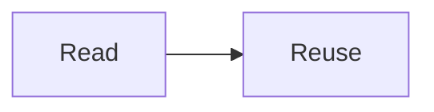
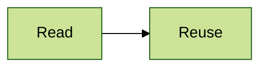

# Mermaid Plugin

**Mermaid** is a [Grav](https://getgrav.org) plugin that turns text into [Mermaid](https://mermaid.js.org) diagrams, such as flowcharts, timelines and sequence diagrams. Diagrams match the theme's light or dark mode, and redraw when a visitor switches. Works with Grav 1.7 and Grav 2.

## Why Diagrams as Text?

Diagrams written as text suit open educational resources (OER) and open publishing:

- **Easy to revise and remix** – anyone reusing your content can edit a diagram's text, with no source file or drawing tool needed
- **Covered by the page's licence** – a diagram is part of the text, so there's no separate image to credit or track
- **Accessible** – labels stay real text, sharp at any zoom, with a title and description for screen readers
- **Portable** – the same diagram shows on GitHub, in Docsify and in many Markdown editors, and stays readable as plain text anywhere else

## Installation

Download the plugin, unzip it into `user/plugins`, and rename the folder to `mermaid`.

## Adding a Diagram

Write the diagram in a code block marked `mermaid`:

````markdown

````

See the [Mermaid documentation](https://mermaid.js.org/intro/) for every diagram type. A diagram with a mistake shows an error box in its place.

For screen readers, give each diagram a title and a short description (like an image's alt text):

````markdown

````

To give one diagram its own [colour theme](https://mermaid.js.org/config/theming.html) or [settings](https://mermaid.js.org/config/schema-docs/config.html), add them at its top:

````markdown

````

A diagram with its own theme keeps it in both light and dark mode. Flowchart boxes can also link to pages, with a line such as `click B "/guide/reuse"`.

> [!TIP]
> Moving from the Mermaid Diagrams plugin? Your pages work as they are – `[mermaid]...[/mermaid]` tags are drawn too. Turn the Mermaid Diagrams plugin off once this one is installed.

## Light and Dark Mode

Diagrams follow the theme with no setup needed:

- **Quark 2 Open Publishing** and **Helios** – their light/dark switch
- **Quark Open Publishing, Open Matter and Learn2 with Git Sync** – the theme's Dark Mode setting
- **Other themes** – the visitor's system setting

For a theme with its own switch that isn't followed, set **Dark Mode** to Always Dark or Always Light. Diagrams always print in light mode, ready for white paper.

## Settings

- **Diagram Alignment** – left, centre (the default) or right
- **Light Mode Colours** and **Dark Mode Colours** – Mermaid's colour theme for each mode
- **Look** – Classic (the default) or Hand-drawn, a sketch style
- **Font** – the site's font (the default) or Mermaid's own
- **Diagram Width** – fit to the page (the default), or natural size, scrolling sideways when wide
- **Dark Mode** – Auto matches the theme (the default); or Follow System, Always Dark or Always Light
- **[mermaid] Tags** – also draw tags from the Mermaid Diagrams plugin (on by default)

Mermaid is a large file, so it's only added to pages with a diagram.

## Credits

Includes [Mermaid](https://github.com/mermaid-js/mermaid) 11.17.2 by Knut Sveidqvist and contributors (MIT licence).

`examples/mermaid-test.md` is a test page to check diagrams after an update.
