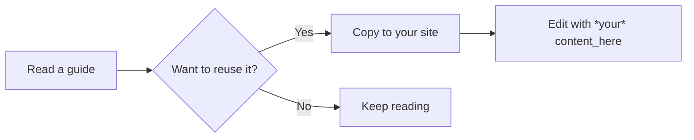
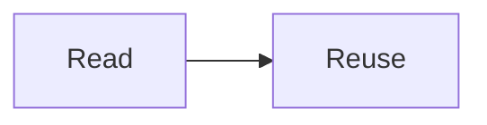
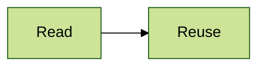

A test page for the Mermaid plugin. Copy this file into a site's `user/pages` (for example as `99.mermaid-test/default.md`), then check it in light and dark mode, and printed from dark mode. Each diagram should match the mode on screen, and print in light colours.

## Fenced block

The labels should read as written, including `*your*` and `content_here`.



## Older [mermaid] tags

This sequence diagram uses the Mermaid Diagrams plugin's tags. The mention of [mermaid] in this sentence and the heading above should be left alone.

[mermaid]
sequenceDiagram
    Author->>Grav: Save page
    Grav-->>Reader: Show diagram
[/mermaid]

## Accessible

A screen reader should announce the title and description.



## Own colour theme

This diagram should stay green in both light and dark mode.



## A diagram with a mistake

This should show an error box, while the other diagrams still draw.

```mermaid
flowchart LR
    A -->
```

## Examples that should not be drawn

A plain code block:

```
flowchart LR
    A --> B
```

A [mermaid] tag shown inside a code block:

````markdown
[mermaid]
flowchart LR
    A --> B
[/mermaid]
````
